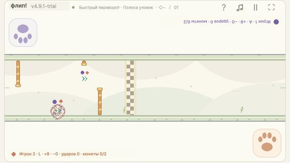

# FIX491 — 4.9.1-trial

Исправление трёх замечаний пользователя от25октября. Базовая версия3214a10 (4.9.0) сохранена. Поручение проверено в исходном чате01a13ea2-10f9-7821-b785-5c3a7e30b079, turn01a17197-1b32-72e3-abea-d4246a3fc667. Игровая и итоговая поставка приняты Каталитиком после независимых проверок. Финальная ревизия доступна в истории Git этого отчёта.

[Играть](http://127.0.0.1:4184/) · [ZIP4.9.1](../Releases/flip-race-v4.9.1-trial-webgl.zip) · [Матрица требований](FIX491-STATUS.md).

## Что исправлено

| ID | Результат | Проверка |
|---|---|---|
|F01|Бег по любой опорной стенке не собирает finish-цель на пяти трассах|RED16случаев → GREEN0; whole-race и wall-isolation разделены;5×2×6steps|
|F02|На «Полосе» обычный проход пропускает цель, прицельный манёвр берёт|Зафиксированные исходные safe/full inputs; оба профиля,0ударов/9обычных наград; ±33мс и30/60fpsфазы|
|F03|Только две компактные стрелочки, без зелёного прямоугольника|Одна геометрия четырёх штрихов для изображения и непрерывного сбора; реальные1280×720/568×320|
|F04|Сохранены ×2/.25движущихся секунды,55ед и настоящий выигрыш.25с|Одинаковые времена ввода без цели; личный сбор, FIFO, пауза, удар, реванш и границы финиша|

Внешние размеры стрелок24×20мировых единиц, толщина3. Геометрия — объединение четырёх штрихов с круглыми концами. Изображение строится из того же расстояния до отрезков; небольшая погрешность растра (<.05мировой единицы на ось) не расширяет collider. Непрерывный solver использует корни четвёртой степени для концов и квадратные границы для прямых участков, без выборки по кадрам. Старые FinishWidth/FinishHeight/Radius не могут добавить невидимую прямоугольную зону. Новых правил нажатия/направления/воздуха нет.

Цели: MixedX7712/Y80; остальныеX7780/Y64, кроме FlowY176. Самый поздний контакт тела оставляет182ед на Mixed и114на других, при необходимых110. Все камни, обе части ворот, длина, обычные награды, ловушки и монеты сверены с исходными хешами и сохранены.

Mixed: обычное последнее нажатие Main7591.7736/Fast7676.9171; прицельное Main7639/Fast7650. Исследованные непрерывные окна: Main7603…7675 (~327мс), Fast7632…7668 (~164мс). Проверены номинал±33мс и разные фазы30/60fps; обычный пропуск тоже выдерживает±33мс. Это инженерная устойчивость пробы, не доказательство удобства для детей.

## Последующий отзыв пользователя — 25 октября

На «Полосе уловок» с «Быстрым переворотом» пользователь не смог собрать рывок при заходе снизу без удара о кольцо, но нашёл возможность чистого сбора сверху и оценил это различие как удачное решение. Расположение оставляем: сохраняем выбор стороны подхода, чистый верхний маршрут и возможность пропустить бонус. Нижний подход не упрощаем автоматически ради симметрии. [Запись плейтеста и контекст трассы](../../flip-race/docs/flip-race-mixed-course-concept-2026-10-20.md). Это дополнение к отзыву, без изменений кода или сборки.

## Диагноз и красный тест

Команда до production-исправления:

    dotnet run --project Tools/Fix491/Fix491.csproj
    FAIL automatic finish collection reproduced:16 cases

Exit1. [Первый результат](fix491-red.json), [повтор](fix491-red-repeat.json), полные исходные stdout сохранены рядом в.txt. Тот же регрессионный сценарий после правки: [PASS0](fix491-green.json).

Причины: край старого прямоугольника Y32/208 находился ровно в14ед от центра бегущего по стенке тела, поэтому касание давало бонус; обычные маршруты последнего препятствия Mixed уже пересекали цель; две стрелки были смещены от её центра. Flow без игровых действий действительно собирал бонус целиком, несмотря на9ударов.

Старая ложноположительная приёмка проверяла возможность специально уклониться: +10к последнемуMaininput либо дополнительныйFastinput7730, и существование take/skip. Она не проверяла отсутствие автоматического сбора по стенке и обычный проход без finish-aim. Новая регрессия фиксирует именно эти случаи. Старый Iter49Finish теперь явно перенаправляет на текущую проверку; исторические эталоны не перегенерированы.

## Выполненные проверки

- [FIX491production](fix491-finish-proof.json):62117проверок;5трасс×2профиля×6steps, чистый ordinary bypass/deliberate take, геометрия, полная длительность, одинаковый временной ввод, ±33мс и кадровые фазы.
- [Все10семейств ядра](fix491-core.txt): PASS; Finish2054, Flight2424; прежние parity/V2/V3/V4/tune/control/modes/offset-gates сохранены. Cross-engine baseline не регенерировался.
- [Content](fix491-content.json):26572проверки/282игры; все маски монет/старых и новых ловушек, оба профиля/шестьsteps, ordinaryfinish0, личные состояния и очереди.
- Full tracks15256проверок, локальные safe±60мс и [окна обычных наград](fix491-tracks-windows.json) — PASS. Settings736/114roundtrips — [PASS](fix491-settings.txt).
- [UI](fix491-ui.json):5286проверок, повтор после последней правки текста; виды, ghost/пауза/лапки и эквивалентность Core. FlightUiCompile0ошибок/предупреждений у исполнителя.

## Реальный браузер

[Все native попытки](fix491-native-summary.json) сохранены с входами/событиями/результатом и кадрами. На568×320 оба профиля Mixed: оба0ударов/9обычных наград, прицельный33.05с/.25/55, обычный33.30с/finish0. PCFlow/Main также дал чистую пару33.05/33.30. Все пять целей сфотографированы без box. Независимый Каталитик осмотрел PC/568 и подтвердил Flow/Fast без единого игрового нажатия:40.50с/9ударов/finish0 против4.9.0:40.25с/finish1/.25/55.

Ранние PCMixed и отдельные Long/Short/Cascade попытки не выдаются за идеальные маршруты: автоматизация местами пропустила обычную награду, попала в ловушку или препятствие до цели. Их записи сохранены честно; чистые Mixed подтверждены последующими actualphoneразмерами. Никаких новых игровых проездов ради очистки истории не требовалось.

## Поставка

Обычный WebGL target, не forced-stage. Финальная сборка `Builds/WebGL-v4.9.1-final`:5файлов/9020818байт, FLIP_BUILD_OK, Unity exit0. Последняя пересборка заменила остаточную подсказку «Площадка» на «Стрелки», сохранив проверенные Core/изображение/позиции. Обычный build по умолчанию также использует4.9.1-trial; при выпуске явно задан FLIP_BUILD_VERSION.

ZIP:8888430байт. SHA256 `a3d59215a493cb6c3382eb4dec87549450d5fd4fc551a8652c65b847a30ae04c`. [Manifest](../Releases/flip-race-v4.9.1-trial-webgl.zip.manifest.json), [независимая проверка и свежая распаковка](fix491-package-verification.json): все5хешей source/ZIP/manifest/extraction совпадают; rootindex, относительные ссылки, codec и WASM header проверены.

[Фактическая распаковка](fix491-native-unpacked.json) запущена с4213 наPC/568×320,4.9.1/ready/6+6героев/2лапки, warnings/errors0. Каталитик независимо открыл4213 и перепроверилZIP. [Постоянный4184](fix491-native-stable.json) действительно показывает4.9.1 и [раздаёт](fix491-stable-server.json) `Builds/WebGL-v4.9.1-final`; замена только после приёмки.

Предыдущие4.9build/ZIP не удалены; прежнийZIP SHA256 `7731a989912b7f6f2c10c3df936d760000954fdb3768cacc766b137d2081730e` повторно совпал. Публичной загрузки не было. Viewport возвращён к обычному размеру. Удобство на настоящем телефоне и игровой отзыв двух детей остаются человеческим плейтестом; браузерная проверка их не подменяет.
