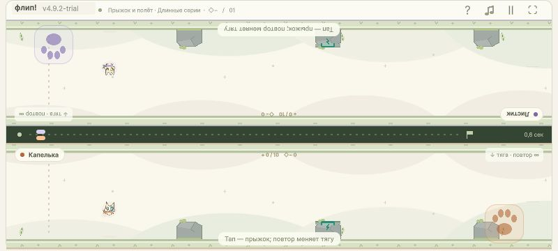

# FIX492 — 4.9.2-trial

Прямой запрос пользователя от25октября: на RedmiNote14/2400×1080 лапки кажутся не полностью нажимаемыми ближе к боковым краям; сдвинуть внутрь, вертикальное положение сохранить. Исходное сообщение прочитано через read_thread, чат01a13ea2-10f9-7821-b785-5c3a7e30b079, turn01a171e0-8667-7401-ae79-fd5a9164790a. Базаef2d730/4.9.1. Небольшая поставка выполнена Прогатиком напрямую, Sol/high.

[Играть](http://127.0.0.1:4184/) · [ZIP4.9.2](../Releases/flip-race-v4.9.2-trial-webgl.zip) · [STATUS](FIX492-STATUS.md).

## Изменение

В `PawScreenRect` горизонтальный отступ от пересечения безопасной области и личной области управления увеличен с8до40 CSS/UIединиц только на compactlandscape (`height<=600`). Это сдвиг32ед внутрь, зеркально под правую руку. Y, размер56×56, изображение/прозрачность/обратная связь и общий путь одного pointeredge не изменены. БольшойПК сохраняет прежние8ед. Core, трассы, бонусы и механика ввода не изменены; [хеши исходников](fix492-source-check.json) совпали с базой.

| CSS viewport / вид | Лапка0 (x,y) | Лапка1 (x,y) | Размер |
|---|---|---|---|
|800×360 / split|49,36|695,293|56×56|
|960×432 / ghost|49,36|855,365|56×56|
|568×320 / shared adjacent|188,253|463,253|56×56|
|1280×720 / shared opposite|53,181|1171,544.2|56×56|

На800×360 старыеX были17/727; новые49/695, Y36/293 и readyRects совпадают. Для соседней посадки отступ считается от правого края каждой личной половины, для верхнего напротив — зеркально слева.

## Проверки

Сначала регрессия на старом production:

    ./Tools/Iter49Ui/Run.ps1
    FIX492 compact40/desktop8 horizontal inset:20 !=52

[RED](fix492-red.txt), exit1. Это целевой тест запрошенного расположения, не воспроизведение аппаратного перехвата касания. После правки [GREEN](fix492-ui.json):22854проверки,128pawcases,8actualUpdateequivalenceпотоков. Существующие menu/pause/hold/дваBegan/compatibilitymouse/фон/A/L сохранены. Новые864потока через actualUpdate проверяют9внутренних точек (четыре угла, четыре края и центр) каждого видимогоRect, обоих игроков, четыре вида, оба профиля, широкие размеры иDPR. Проверяется не только действие на фоне, но и feedback clock именно выбранной лапки; оппонент не действует и не подсвечивается.

DPR1/2/2.5/3 и асимметричныйsafearea (left12/right16/top14/bottom10) покрыты managedUIseam. Framebuffer2400×1080 проверен как800×360@3 и960×432@2.5. Это модели физического разрешения/CSS, не измеренныйDPR конкретного Redmi. Полная матрица трасс/бонусов не повторялась: Core не менялся.

Фактический браузер: [960ghost](fix492-native-960-ghost.json), [568shared adjacent](fix492-native-568-shared-adjacent.json), [ПК](fix492-native-pc-shared-opposite.json). В каждой проверке левый внутренний край верхней/первой лапки и правый внутренний край нижней/второй дают одно действие своего игрока; гравитация первого действия и отсутствие реакции оппонента проверены. Нативное физическое одновременное касание двумя пальцами не заявляется: соответствующая проверка — actualUpdate/twoBegan seam. Каталитик независимо подтвердил800split/точныйсдвиг/Y/56/ready и два edgeclicks; source/testreview PASS. Очень короткую визуальную вспышку screenshot не выдаёт за отдельное аппаратное измерение feedback.

## Поставка

Обычная WebGL4.9.2-trial (`Builds/WebGL-v4.9.2-final`), UnityFLIP_BUILD_OK/exit0;5публичных файлов/9020831байт. [ZIPmanifest](../Releases/flip-race-v4.9.2-trial-webgl.zip.manifest.json):8888496байт, SHA256 `9385b21ffe7ad91a3b0117736e9e6fee2cc707ddb1ac5296982a7711d0946466`.

[Свежая распаковка](fix492-package-verification.json) `Builds/WebGL-v4.9.2-unpacked`: все5хешей source/ZIP/manifest/extraction совпадают, rootindex/относительные ссылки/codec/WASMheader проверены. [Фактический запуск извлечённого ZIP](fix492-native-unpacked-800.json) на4215,800×360:4.9.2, rect49/695, оба edgeclicksPASS, consolewarnings/errors0. [Стабильный4184](fix492-native-stable.json) загружен с4.9.2, [раздаваемый каталог](fix492-stable-server.json) — финальная сборка. Viewport восстановлен.

Предыдущая4.9.1 иZIP сохранены; SHA256старогоZIP `a3d59215a493cb6c3382eb4dec87549450d5fd4fc551a8652c65b847a30ae04c` совпал. Чужая незакоммиченная правка `FIX491-RELEASE.md` сохранена побайтно и не включается в функциональный коммит FIX492. Публичной загрузки не было.

Аппаратный симптом на настоящем Redmi не воспроизведён, причина OS/browseredge rejection не установлена. Выполнен прямо запрошенный сдвиг с проверенным inputRect; подтверждение на самом телефоне остаётся пользовательской проверкой.
