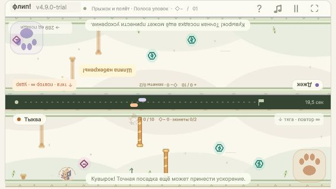
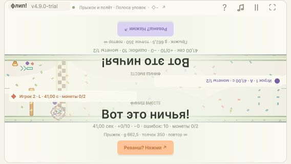

# ITER49 / 4.9.0-trial

Полная поставка шести требований исходного запроса. Версия в UI/DOM: **4.9.0-trial**. Исходная база `5e8c599`; итоговый локальный commit указан в истории Git. Production заморожен перед сборкой: [43 source hashes](iter49-final-source-hashes.json); после сборки все hashes совпали. Source review Каталитика и независимых Sol/high reviewers существенных замечаний не обнаружил.

[Играть: постоянный4184](http://127.0.0.1:4184/) · [ZIP для itch.io](../Releases/flip-race-v4.9.0-trial-webgl.zip) · [Статус/владение](ITER49-STATUS.md).

## Шесть требований и приёмка

| ID | Результат | Доказательства |
| --- | --- | --- |
| F01 / 00–01 | На всех5 трассах горизонтальная площадка28×8, X7780; Y32, Flow208. Полный рывок×2 на0.25сек движения, runway112ед после самого позднего контакта; камни, ворота и длины сохранены. | [Finish19518 assertions](iter49-final-finish.json):60 take/skip/same-input игр, обе физики×6dt. Чистый полный33.05с, отказ33.30с. [Нативные5трасс](iter49-final-native-pads.json), кадры ниже. |
| F02 / 02 | Джек и Тыква во всех позах, мягкий стиль и определяющие признаки;6 больших карточек3×2. Старые4 героя pixel-identical. | [Artwork7083](iter49-02-art.json),1536 старых/768 новых поз; [листы](iter49-02-art-sheet-5-0.png). Независимая browser приёмка root568×320 и Progatik1280×720; native Jack4/Pumpkin5, готовность и забег. |
| F03 / 03 | Только Mixed:2 личные монетки (+1, максимум2),2 дополнительные обычные избегаемые slow-зоны; исходные2 ловушки сохранены. Монетка Тани, личная яркая доступность/метки, HUD и итоги. | [Content26571/282 игр](iter49-final-content.json): все подмножества×2физики×6dt, индивидуальный сбор/сброс/лимит, сохранение движения. [Native факты](iter49-final-native-coin.json): A наX3175.92 → coins[1,0] наX3244.56/Y153.97; видимая монета второму сохранена. Отдельный фактический финиш41с/41с с1/2 и0/2; PC и568×320. |
| F04 / 04 | «Два поля + призрак»: живой противник в настоящих Distance/Y/позе, alpha0.30, рисуется под своим; совпадение без смещения; за краем указатель вместо ложного тела. | [Final UI5286](iter49-final-ui.json):70projection/pose fixtures,12actual Update equivalence streams. Native root проверил наложение одинаковых героев, Y и слои; [живой выход за край](iter49-final-native-ghost.json) при реальном отрыве303ед, без injected state. |
| F05 / 04 | Full убран; старое состояние переводится в Half с сохранением прочих настроек. Центрированная прежняя высота дорожки; камера4.8.1 неизменна. | [UI](iter49-final-ui.json) проверяет Initialize/Measure/Apply migration. [Camera638586/11 игр](iter49-04-camera.json). Native3вида/noFull, adjacent Half rect[9,106.25,550,132.5] при568×320. |
| F06 / 05 |2 полупрозрачные лапки под локальную правую руку, верхняя повёрнута180°. Один pointer-down даёт одно действие; независимы для двоих, фон иA/L сохранены; безопасная область/DPR. | [UI5286](iter49-final-ui.json):32paw cases и8Update streams,2Began/hold/move/end/crossboundary/keys/pause. Native root: отдельно верхняя и нижняя лапка прыгнули только своим героем; на паузе скрыты. |

Финальный staged whitespace check включил новые Unity.meta и verification EOF: удалены только завершающие пробелы/пустые строки, production43hashes неизменны. После этой очистки Finish19518 и UI5286 повторно PASS; final evidence обновлено. Исторические checkpoint hashes описывают свои прежние bytes.

## Регрессия и build

[Полный ParityRunner](iter49-final-core.txt): original963, V23554, V3865, V41770, TUNE1009, CONTROL2166, FINISH1765, FLIGHT1772, MODES1190, offset-gates2960 — PASS. Settings736/114roundtrips, TrackProofFull14908 и compile всех Presentation — PASS. Cross-engine baseline не регенерировался. Обновлены только obsolete finish expectations и test-only deep-copy личной монеты. [Контрольные отчёты](iter49-03-report.txt).

Обычный Unity WebGL build, не shared-stage: `Builds/WebGL-v4.9.0-final`,5файлов / **9021126байт**, Unity exit0/FLIP_BUILD_OK. [Web manifest](iter49-final-web-manifest.json). Существующие таймауты удалённого Accelerator/CDP не помешали успешной сборке. Native final console warnings/errors: [пустой массив](iter49-final-native-console.json).

ZIP: **8888516байт**, SHA256 `7731a989912b7f6f2c10c3df936d760000954fdb3768cacc766b137d2081730e`. [Manifest](../Releases/flip-race-v4.9.0-trial-webgl.zip.manifest.json), [независимая распаковка](iter49-package-verification.json). Все5 записей побайтно совпали с исходным Web и свежими распакованными файлами; root отдельно повторил проверку ZipArchive.

Фактические каталоги раздачи:

- Постоянный `http://127.0.0.1:4184/` → `F:/Home/Game/flip-race-unity/Builds/WebGL-v4.9.0-final`.
- Принятая проверка реальной распаковки использовала4211 → `F:/Home/Game/flip-race-unity/Builds/WebGL-v4.9.0-unpacked`. После приёмки временные4209/4210/4211 закрыты; файлы распаковки сохранены. [Точная очистка своих серверов](iter49-server-cleanup.json).
- [Смена сервера](iter49-stable-server.json): остановлен только повторно проверенный собственный game Node PID20264 с точным commandline4.8.1. Все файлы4.8.1 сохранены; старый ZIP SHA256 `a459e94345dbadeb112a6eac4a1041fba2829e7760127379c1893be90d19f2ef` повторно совпал.

Независимая конечная приёмка Каталитика PASS:4211 загрузил реальную свежую распаковку без ошибок, UI/DOM4.9.0-trial,6+6героев и новые лапки. Постоянный4184 отдельно открылся с теми же4.9/6+6героями/2лапками/3видами. Viewport восстановлен; постоянная вкладка4184 оставлена пользователю.

## Сохранённые native кадры

[Личная доступность монеты](iter49-final-native-personal-coin.jpg) · [PCитоги](iter49-final-native-pc.jpg) · площадки: [Long](iter49-final-native-pad-long.jpg), [Short](iter49-final-native-pad-short.jpg), [Flow](iter49-final-native-pad-flow.jpg), [Cascade](iter49-final-native-pad-cascade.jpg), [Mixed](iter49-final-native-pad-mixed.jpg).

Граница доказательств: это реальный Chromium WebGL с нативными click/key и мобильным viewport, не физический телефон. Multitouch проверен через actual Update streams; физический touch/iOS/Android и itch.io iframe не заявляются. Публикации на itch.io не было. Человеческий плейтест удобства/интереса из исходного плана остаётся после технической поставки.
