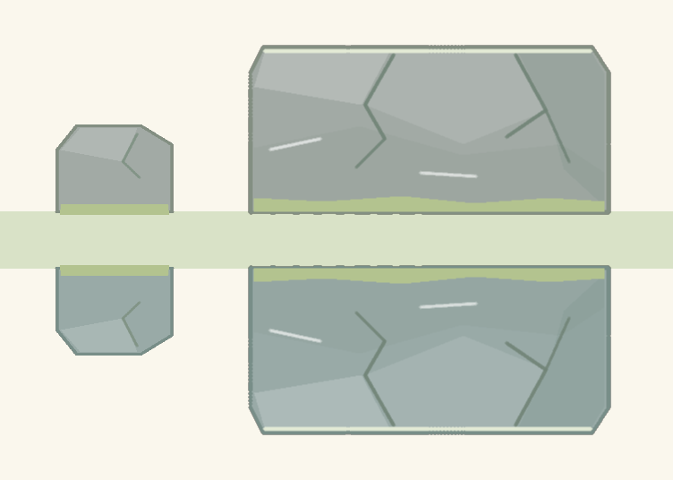

# Крупные камни — 4.4.0-trial

Новая широкая плита имеет собственный генератор [LargeRockArtwork.cs](../Assets/Scripts/Presentation/LargeRockArtwork.cs), отдельные floor/ceiling текстуры и три крупные грани. Палитра и линии продолжают стандартные камни. Конструктор `CorridorArtwork` создаёт обе текстуры один раз; рисование кадра использует кэш. Для препятствий шириной от160 используется эта семья.

Размер исходного рисунка216×108, физический прямоугольник `[8,208]×[8,100]` соответствует200×92. Симметричные поля8 единиц позволяют зеркально перевернуть текстуру и сохранить точную плоскость/ширину. Посадочная метка рисуется отдельно по физическим `X`, `Height`, `LandingWidth`; смена рисунка не расширяет контакт.

Сравнение экспортировано Unity непосредственно из тех же генераторов, при общем масштабе2 пикселя на игровую единицу. Это не растяжение стандартного рисунка. Метод `FlipRace.Editor.RockArtworkExport.Export` воспроизводит PNG; `FLIP_EXPORT_ARTWORK=1` также включает экспорт перед WebGL-сборкой. Runtime-текстуры освобождают CPU-копию после загрузки, только проверочные экземпляры сохраняют читаемые пиксели.

18 октября2026: компиляция Presentation с настоящими Unity DLL — PASS без предупреждений; Unity batch export завершился с кодом0. PNG визуально проверен: обе ориентации, большая горизонтальная грань, трещины, палитра и соотношение размеров. В WebGL review проверены реальные мобильные сцены568×320: [потолочная плита рядом со стандартным камнем](tracks-long-full-scene.png) и [напольная плита](tracks-short-large-floor.png), каждая сразу в обеих половинах с поворотом верхней180°. Полные маршруты с посадками выполнены в браузере без ударов, см. [browser report](TRACKS-BROWSER.md).
