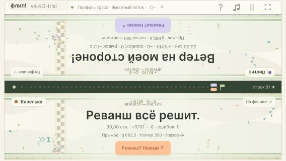
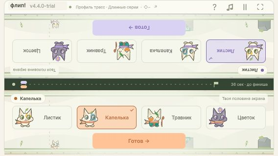

# 4.4.0-trial — браузерная проверка

18 октября 2026. WebGL review: `Builds/WebGL-v4.4.0-review`, пять файлов, 8 680 125 байт. Исходник трасс SHA-256 `D3B0285856E2D7A45284435A5AD5784850F6713DA1643B961CBBD9D1CDEF7A8D`. Это проверочная сборка: вопрос бессрочного подтверждения after-кольца остаётся открытым, см. [численный контрпример](TRACKS-LONG-TAIL-RED.txt). Успешные заезды ниже не доказывают чистый подход к финишу для произвольно затянутого полёта.

## Реальные заезды

Codex in-app browser, viewport568×320. Ввод — реальные клавиши A/L, состояние читается только из опубликованного DOM-снимка. Никаких подстановок состояния Unity. Оба игрока проходят каждый маршрут одновременно.

| Трасса | Безопасный путь, оба игрока | Полный сбор, оба игрока | Удары / отрицательные кольца |
|---|---:|---:|---:|
| Длинные серии | 36,0 с; 0 наград | 33,2 с; 9 обычных + финиш | 0 / 0 |
| Быстрые связки | 36,0 с; 0 наград | 33,2 с; 9 обычных + финиш | 0 / 0 |
| Высотный поток | 36,0 с; 0 наград | 33,2 с; 9 обычных + финиш | 0 / 0 |

Отдельная дуэль на «Высотном потоке»: одинаковые девять обычных наград, ноль ударов; верхний игрок берёт финишную цель и заканчивает за33,2 с, нижний пропускает её и заканчивает за33,3 с. Фактическая разница0,1 с.

[Журнал нажатий и итогов](tracks-browser-runs.json) сохраняет все девять попыток, включая один неудачный запуск Flow: автоматизация задержалась примерно на4,7 с и отправила вводы4415,77/4835,18 только приX4986. Получились два удара и34,5 с. Повтор без промежуточных снимков подтвердил33,2 с/0 ударов/полный сбор. Неудачная попытка не удалена и не считается чистым прохождением.

## Интерфейс и версия

Отдельный ранний candidate использовал те же Presentation/Store/Diagnostics, но прежнюю геометрию двух трасс. На нём выполнены112 завершающих проверок карточек: оба игрока, все четыре героя, центр и четыре внутренних угла каждой карточки, три зазора и внешний промах на каждом из размеров568×320 и844×390. Размеры122×48 и172×56 CSSpx; верхняя половина проверена с настоящим поворотом180°. Выбор не подтверждает готовность; готовность включается отдельной кнопкой. Повторный выбор того же героя сбрасывает только его готовность; одинаковые герои доступны обоим игрокам.

- Собственный прыжок400 сохранён после выбора другой трассы и перезагрузки. Возврат к профилю350/662,5/∞ даёт точные значения и сохраняет отдельный custom400. Проверка выполнялась на отдельном тестовом origin4197, не перезаписывая пользовательский набор origin4184.
- Новый вход на4184 выбирает full-long и Jump350/g662,5/∞. Меню содержит все три трассы. Версия `v4.4.0-trial` берётся из `Application.version`, видна возле названия в ready, racing, результатах, меню, паузе и портретной заглушке.
- Пауза замораживает elapsed/дистанцию; ввод A/L в portrait не запускает игру. Реванш сбрасывает дистанцию/награды/удары и сохраняет героев/профиль.
- Полный экран входит и выходит штатной HTML-кнопкой: DOM `:fullscreen` → HTML / отсутствует. Проверка завершена без viewport override; все временные размеры затем сброшены.
- Ошибок browser console уровняerror в review и unpacked нет.

[Исходный журнал UI](tracks-ui-browser-checks.json) содержит и ранние неудачные assertions самого прототипа polling: они читали снимок до обработки нажатия. После ожидания опубликованного целевого состояния обе полные серии из56 проверок прошли. Это отделено от итоговых112 проверок и не скрыто как несуществовавшая попытка.

## Игровая графика

Фактические сцены проверены визуально: [ceiling slab и стандартный камень](tracks-long-full-scene.png), [floor slab](tracks-short-large-floor.png), [низкое кольцо и ловушка в центре](tracks-flow-low-middle-rings.png), [цепочка на разных высотах](tracks-flow-air-chain.png), [центральное положительное кольцо](tracks-flow-middle-ring.png). Площадки/метки соответствуют граням, новые плиты отличаются от стандартного валуна, обе половины читаются с их собственным поворотом. Ближайшие воздушные комбинации видны заранее; это не утверждение, что вся длинная серия помещается на экране одновременно.

## Проверка распакованного ZIP

Отдельный сервер4198 загрузил `Builds/WebGL-v4.4.0-review-unpacked`. Подтверждены версия, начальный профиль и меню всех трёх трасс. Затем оба игрока реально прошли Flow negative:33,5 с, девять обычных наград +финишная, одна отрицательная, ноль ударов. [Снимок результата](tracks-unpacked-negative-result.png), [проверка упаковки и хешей](tracks-review-package-verification.json).

Проверка проведена на desktop-browser с мобильными размерами. Физический телефон, настоящий мультитач и внешняя itch.io iframe-публикация не проверялись. Публикация не выполнялась. Универсальное свойство чистого финиша требует ответа на уже заданный вопрос о сроке возврата; review не объявляется окончательным выпуском.
