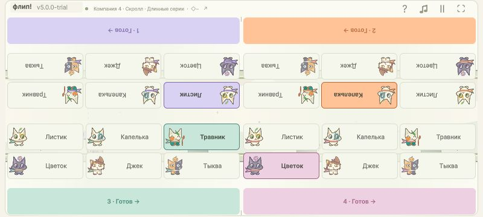

# V5 PARTY — 5.0.0-trial

Новый режим компании2–4 на одном устройстве, отдельный от прежних двухпользовательских видов. Источник: прямой запрос пользователя в чате Каталитик01a13ea2-10f9-7821-b785-5c3a7e30b079, turn01a18278-c0f5-7443-9b7a-3da7fdbd3558 от28октября2026; только левая граница, старую камеру сохранить, человеческий комфортный плейтест отложен. [Контракт](../../flip-race/docs/flip-race-v5-party-delivery-2026-10-28.md), [STATUS](V5-PARTY-STATUS.md).

## Поведение

Меню «Вид и посадка» → «Компания» →2/3/4участника и камера. Четверти:2TL/BR,3TL/TR/BR,4TL/TR/BL/BR; верхние личные панели повёрнуты180°. Все6героев доступны каждому, дубли разрешены; готовность/реванш ждут всех. Карточки и готовность44UIед; лапки56×56 с прежними40compact/8desktop горизонтальными и8вертикальными отступами от пересечения safearea и личной зоны. КлавишиA/L/S/K по игрокам1/2/3/4; прежние A/L сохранены. Номер и постоянный цвет повторены у героя, лапки и результата; круг/ромб/треугольник/квадрат показывают личную доступность бонусов.

Постоянная камера: C0=−288,8, логическое окно1520×240, cameraLeft=C0+(L/36)×activeElapsed. Для всех5полных трасс L7920, скорость220ед/с. Отсчёт/пауза не учитываются,36с не ограничивают движение; после общего исхода камера замирает. Единый масштаб вписывает окно в привычный половинный коридор по центру; resize меняет только проекцию. Эти численные параметры выбраны Astra/high по каноническому800×360: стартовый герой на19%ширины; это сохранение экранной позиции, а не старого независимо масштабированного worldoffset.

Бегущий выбывает при Distance+14<=cameraLeft. Справа выбывания нет. События сравниваются внутри реального sweptшага вместе с recovery/effects/collision; более ранний исход выигрывает, при совпадении — финиш. После исхода нет движения/действий/начислений. Первый финиш задаёт победителя, остальные продолжают до своего исхода. Последний бегущий не выигрывает автоматически; все выбыли без финиша — нет победителя. Обе камеры компании ждут всех; прежние режимы сохраняют3,5сgrace.

Камера «За последним»:C0+minDistance только ещё бегущих, без выбывания за экран. Исходы, цвета, бонусы и четыре личных ввода одинаковы в обеих камерах. Бонусы/монеты личные; трассы, принятые профили и ручные настройки сохранены. Другие идеиV5 (solo/боты/скрытые блоки/одежда/разгон) не входят.

## Проверки

- PartyCheck512детерминированных утверждений:2/3/4, готовность/реванш, границы тела/правый выход, точные финиш/выбывание/recovery/эффекты, очередь и личные сборы, оба профиля/custom,36+,dt/порядок, обе камеры. [Core](v5-party-core.txt).
- Полный ParityRunner и неизменённые JSфикстуры:40228снимков/1448208полей, допуск<1e−8. [Лог](v5-parity.txt). Это не заявление побитовой идентичности.
- PartyUi34434проверки/216конфигураций/25020реальныхUpdate, DPR1/2,5/3,safearea,568/800/960/1280, оба профиля/custom, все герои/готовность,4Began+mousefilter, hold/перенос/быстрые повторы, terminal/pause/resize/rematch и18выходов в прежние виды. [Отчёт с SHA256 исходников](v5-party-ui.json). Прежний UI22854PASS[v5-old-ui](v5-old-ui.json), Settings736/114roundtrips[v5-settings](v5-settings.txt), compilation0warnings/errors[v5-compile](v5-compile.txt).
- SharedCamera642997/11реальныхгонокPASS[v5-shared-camera](v5-shared-camera.txt). Старое ожидание33,85с независимо воспроизводится ошибочным на принятомa235d39: правильные8наград/1удар/пропускфинишнойцели дают34,1с. Исправлен только историческийassert; baseline[v5-camera-baseline](v5-camera-baseline.txt).
- FINISH62117проверок всех5трасс/2профилей/6шагов:необязательность, штрихи, честный0,25сэффект, frozenмаршруты. [Proof](v5-finish-proof.json). Трассы и inlineкаталог сохранены, чужойFIX491-RELEASE.md побайтно сохранён и не включается в коммит: [sourcecheck](v5-source-check.json).
- Независимая Coreпроверка КаталитикаSol/high:900сравнений/300синтетическихтрасс,4игрока, обе камеры,dt100s/1s/30Hz/240Hz,reversearrays,recovery/coins/instant/slow/finish/obstacles — без замечаний. ProbeF:/Home/Game/.scratch-v5-core-acceptance-20261028/Program.cs; CoreSHA25638A9B4F39BCB22DC67323002AD4BB9795BE84449A9DA59C171491A50E991D18E.

Роли: Прогатик интеграцияSol/high; party_coreSol/high; party_artworkSol/medium; решение окна/посадкиAstra/high. Singlefileowners соблюдены. [Арт-направление](../../flip-race/docs/flip-race-art-direction.md): существующие образы сохранены; техническая приёмка не означает отдельное одобрение Тани. VIEW/TOUCH/REWARD обновлены в статьях браузерного репозитория.

## WebGL и архив

Обычная WebGLTrial,5.0.0-trial,Builds/WebGL-v5.0.0-final; FLIP_BUILD_OK9038713bytes/exit0[v5-build](v5-build.txt). Первый запуск ожидал недоступный Accelerator; последующие используют perprocess endpoint127.0.0.1:1 и download/uploadfalse, не меняя глобальные или проектные настройки кэша. [Unity CLI](https://docs.unity3d.com/cn/current/Manual/EditorCommandLineArguments.html).

[ZIP](../Releases/flip-race-v5.0.0-trial-webgl.zip):8906342байт,SHA256`7e58ee62ab8a759726eb3794290e5bf6d9a194a81935622d2aa2b45bbe73225c`. Финальный архив создан повторно после text-only замечаний про «Оба» и подписьA/L/S/K. Свежая распаковкаBuilds/WebGL-v5.0.0-unpacked-delivery:5файлов,все source/ZIP/manifest/extractedSHA256совпали; rootindex/4relative refs/gzip/WASM/path/linkchecksPASS[v5-package](v5-package-verification.json). Предыдущие4.9.1/4.9.2архивы сохранены.

Нативная проверка и окончательная приёмка фиксируются в STATUS и v5-native.json; независимая финальная приёмка завершена PASS. Человеческое исследование удобства физического телефона/планшета перенесено пользователем; эмулированные размеры/DPR и четыре managedBegan не выдаются за четыре физических пальца. Публичная загрузка на itch.io не выполнялась.

Финальная ariaпоправка выполнена в исходном HTMLшаблоне и сгенерированном index одной одинаковой заменой строки describeControls; неизменность четырёх Unityruntimeфайлов и происхождение +308байт зафиксированы в[v5-html-adjustment](v5-html-adjustment.json). Итоговые5файлов9039021байт. Это не новая компиляция механики. Проверяющий скрипт учитывает и проверяет точную производную от исходной Unityсборки9038713байт.

[Фактический браузер](v5-native.json):800×360/960×432/568×320/1280×800,2/3/4участника, обе камеры, четыре одинаковых героя/номера,4клавиши/4edgeclicks, измереннаякамера220, pause/resizeсохранение; естественные всеисходы. Финальная распаковка4217и4184:5.0,4выбора, исправленный runtimearia иconsole0; нейтральнаяпауза подтверждена на финальнойWASM. [ВсеHTTPхеши](v5-stable-http.json) совпадают с окончательнымZIP. [Независимая итоговая приёмка PASS](V5-PARTY-CATALYTIC-ACCEPTANCE.md).

