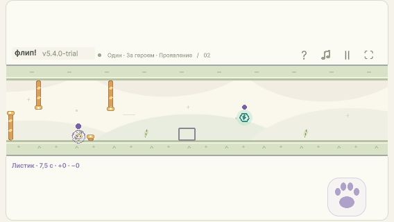
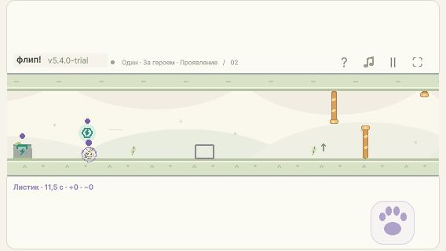

# Приёмка скрытых блоков и двух трасс

3 ноября 2026. Unity 5.4.0-trial, regular trial WebGL. Интеграция и финальная приёмка выполнены Каталитиком в исходном чате по прямому запросу пользователя. База игрового кода — 4bf0d85; исходники перед сборкой заморожены, их хеши сохранены в отчётах UI.

## Результат

Добавлены «Перехваты» и «Проявление», по 7920 единиц / 36 с базового бега, общая геометрия для Основного управления и Быстрого переворота. В первом уровне три плотные серии, воздушные пары наград и три скрытых камня; во втором четыре связки, пять скрытых камней, включая два внутри серий. Старые пять трасс и параметры полёта сохранены.

Скрытые камни проходят общие для всех игроков состояния hidden → warning → solid. Предупреждение начинается за 440 единиц; задержка 0,4–1,2 с с шагом 0,2, default 0,8. Контур ещё не препятствие и не опора. Активация откладывается, пока активное тело пересекает будущий камень. Освобождение объёма распознаётся с задержкой не более 1/240 с. Повтор очищает состояния и сохраняет настройку.

## Проверки

| Область | Подтверждение |
| --- | --- |
| HID-01, CONTROL, GATE, REWARD | [Core](v54-hidden-core-2026-11-03.md): 13 групп / 1005 assertions; точный reveal, пять задержек, safe activation, реальные столкновения/посадки, shared order, pause/retry/snapshot |
| HID-02/03, FINISH | [Трассы](v54-hidden-tracks-handoff.md), [маршруты](v54-hidden-tracks-witnesses.json): PASS 52 assertions; четыре map/profile сочетания; чистые safe, air, pad, finish; реальные 0,3/0,25 с; один удар и продолжение; конечные отрицательные проверки бездействия и пропуска |
| HID-04, VIEW, TOUCH, SOLO, BOT | [HiddenUiCheck](v54-hidden-ui-handoff.md), [JSON](v54-hidden-ui.json): PASS 1488 assertions, 1704 Pointer calls; 568×320/1280×720, DPR1/2/3, оба профиля; семь карт, пять задержек, сохранение, 2–4 человека, явное ограничение BOT |
| HID-05, прежняя логика | Root: `dotnet run --project Tools/ParityRunner/ParityRunner.csproj -- Tools/engine-parity-fixtures.tsv.gz` — PASS всех внутренних серий и JS/C# differential: 40228 snapshots / 1448208 fields, tolerance <1e-8. Эталон не менялся |
| HID-05, прежний UI/бот | Root: `Tools/StochasticUiCheck/Run.ps1` — [PASS](v54-stochastic-ui.json): 124089 checks, 2470 layouts, 48 input cases, пять реальных полных гонок и продолжение каждой, bridge 20 checks |
| Независимый просмотр | Core-специалист read-only проверил чужие TracksHidden/UI изменения: существенных замечаний нет. Root просмотрел Core, каталог, меню и фактический выпуск |

## Браузер

Проверена сборка из распакованного ZIP, `http://127.0.0.1:4184/`, IAB Chromium, viewport 1280×720 и 568×320. Версия видна как 5.4.0-trial. Проверены семь карточек, пять кнопок задержки, сохранение выбранных 1,2 с при переходе между картами, запуск «Перехватов» с Fast и «Проявления» с Основным, одиночный финиш после ошибок, пауза и повтор. Нажатия выполнялись настоящими click/key событиями; состояние читалось из опубликованного DOM diagnostics, не изменялось через отладочный код.

Новая карта сохраняется при переходе в BOT; текст ограничения виден, Apply не запускает игру и не подменяет карту. Четыре участника стартуют на «Проявлении» с постоянной камерой и клавишами A/L/S/K. Для 2/3 игроков и полного диапазона DPR дополнительно применяются managed checks, а не заявление о физическом устройстве. Ошибок в browser error console при проверке нет.

Контур физического прямоугольника виден до активации; позже появляется прежний ассет с посадочной меткой. Оба выступа ворот сохранены.

## Артефакты

- Unity 6000.0.64f1, `FlipRace.Editor.BuildGame.WebGLTrial`, `FLIP_BUILD_VERSION=5.4.0-trial`. Лог `Logs/v54-hidden-tracks-build.log`: `FLIP_BUILD_OK`, штатное завершение с code 0. Предупреждения недоступного удалённого кэша не помешали сборке; настройки Unity не менялись.
- Build: `Builds/WebGL-v5.4.0-hidden-tracks`.
- ZIP: `Releases/flip-race-unity-5.4.0-trial-itch.zip`, 9178988 bytes; SHA256 `E1AF3342A6CA7C8E35FB4F79407957D22FEE1DDB4B8EA8D5C33E2480722A0738`.
- Архив заново распакован в `Builds/WebGL-v5.4.0-hidden-tracks-unpacked`; именно этот каталог раздаётся на 4184. Пять файлов / 9320441 bytes, index.html в корне, относительные URL, unity-fallback compression, проверен WebAssembly header.
- [Build manifest](v54-build-manifest.json) и [unpacked manifest](v54-unpacked-manifest.json): пути, размеры и SHA256 всех файлов совпадают.

## Границы результата

Играбельный MVP для следующего плейтеста. Баланс и субъективная разница трасс не объявлены окончательными; технические маршруты не доказывают удовольствие или удобство физического телефона. Проверка ±20 мс относится к первому входу, а не всей трассе. Негативные сценарии не являются исчерпывающим доказательством отсутствия любого обхода. Новые карты доступны людям и SOLO; бот остаётся на прежних пяти картах. JavaScript-проект игровой механикой не расширялся.

Сторонний `Verification/FIX491-RELEASE.md` сохранён без изменений (SHA256 3071311647C1391AF4FF9DC16B1DE0EDA1B735D5B117BD078158C684E7F93CD5). Старые probe-материалы и другие незавершённые документы не включаются в коммит поставки.
