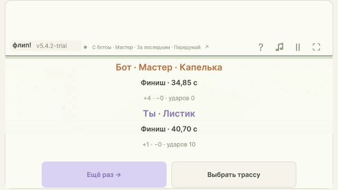

# 5.4.2 — боты на новых трассах

**Принято 4 ноября 2026.** Unity `5.4.2-trial`, код и тесты `856acc5`. Запрос пользователя: добавить ботов на новые трассы, включая «Передумай», сохранив общий алгоритм. [STATUS](V542-NEW-TRACK-BOTS-STATUS.md).

## Результат

Все пять существующих сложностей доступны на Перехватах и Проявлении с Основным и Быстрым переворотом, на Передумай — только с точным Основным. Всего поддерживается восемь карт и 15 сочетаний карты/профиля. Ручные настройки BOT по-прежнему запрещены.

Добавлены пять чистых ориентиров с совместимыми наградами. Это данные карты, а не библиотека случайных готовых забегов. Сохранены формула `pCollect=q`, `pHit=(B/C)*(1-q)`, seed, решения по ходу гонки и прежние лимиты поиска. Невыбранные альтернативные награды остаются физически доступны, но не входят в обязательные цели. Все логические препятствия входят в C.

Прогноз на скрытых трассах копирует текущий общий мир, таймеры и тела участников. Другие участники продолжают обычную физику без будущих нажатий; неизвестный ввод человека не предсказывается. Нельзя искусственно активировать скрытый камень ради намерения столкнуться.

## Критерии и доказательства

| Область | Принятые проверки |
| --- | --- |
| BOT: новые карты, выбранные цели, прежняя формула и карты | [Ориентиры](v542-new-bot-reference-handoff.md): 165 утверждений / 26 полных воспроизведений; [финальная матрица](v542-new-track-bots-postfix-matrix.json): 46 заездов / 1 245 456 утверждений; [пять Мастеров](v542-new-track-bots-postfix-smoke.json): 135 189 |
| HIDDEN: независимые состояния, общий мир, отложенная активация | [Core и исправление производительности](v542-bot-perf-fix.md): прежние 17 групп / 1 324 проверки, новые крупные шаги через reveal/deadline, малое время предупреждения, ускорение перед reveal, перекрытия и порядок участников; [общий мир](v542-new-track-bots-postfix-shared.json): 29 586 |
| CONTROL, VIEW, TOUCH, SOLO | [Меню](v542-new-track-bots-ui.md): 17 766 проверок, 750 новых setup и retry; Hidden UI 1 512, Rethink UI 630, Stochastic UI 124 089; реальные браузерные меню, старт, повтор, лапка и пауза |
| GATE, REWARD, FINISH и прежняя физика | [Регрессия](v542-postfix-regression.md): 40 228 snapshots / 1 448 208 полей, HiddenTracks 52; геометрия и параметры полёта не менялись; ориентиры подтверждают полный выигрыш выбранных наград и финиша |
| Сборка и архив | Пять файлов / 9 333 333 байта; относительные ресурсы и WASM проверены. Хеши каждого файла [сборки](v542-build-manifest.json) и [распакованного ZIP](v542-unpacked-manifest.json) совпали |

Чистые времена ориентиров: Перехваты Основной 33,35 с / Быстрый 32,75 с; Проявление 33,95 с обоими профилями; Передумай 34,85 с. Для Перехватов Основной выбраны 8 обычных наград, Быстрый 10; Проявление 6, Передумай 3. Каждый ориентир отдельно включает полный финишный эффект.

## Исправление найденной задержки

Первый WebGL-кандидат остановился штатной защитной паузой: max combined 324 мс к девятой секунде ([до](v542-browser-perf-before.json)). Причинный контроль выявил излишний шаг 1/240 с даже вдали от скрытых камней. [Диагностика и red → green](v542-bot-perf-fix.md) сохранены; защита паузы, вероятности и бюджеты не ослаблялись.

Теперь ещё скрытый камень ограничивает шаг длительностью предупреждения, уже проявляющийся — ближайшим deadline. Просроченное предупреждение, удерживаемое телом, сохраняет 1/240 с. Полностью твёрдые камни дополнительного шага не требуют. Аналитическое раскрытие и безопасная активация после продвижения всех участников сохраняются. Тот же fixed seed в управляемом сравнении сохранил нажатия, решения и результат; warm max планирования снизился со 115 до 41 мс.

## Реальный браузер

Проверен финальный WebGL в IAB без параллельных CPU-тестов. Измерение включает Advance, диагностическую публикацию и браузерные callbacks; это не полная стоимость GPU-отрисовки. Во всех четырёх попытках `measurementComplete`, нет кадров этого измерения >50 мс и автоматических пауз. Seed исходного дефекта воспроизведён в управляемом тесте; браузерные попытки используют новые естественно выданные seed.

| Трасса / профиль / бот | Seed | Фактический исход бота | Max / P95, мс | Доказательство |
| --- | ---: | --- | ---: | --- |
| Перехваты / Основной / Новичок | 780436308 | 35,35 с; 1 удар, 3 обычных + финиш | 31,90 / 1,40 | [первый забег](v542-browser-novice-after.json) |
| То же, повтор | 4066748159 | 37,10 с; 4 удара, 3 обычных, без финиша | 31,00 / 2,50 | [повтор](v542-browser-novice-retry.json) |
| Передумай / Основной / Мастер | 2812090055 | 34,85 с; чисто, 3 обычных + финиш | 5,50 / 1,40 | [Мастер](v542-browser-rethink-master.json) |
| Проявление / Быстрый / Уверенный | 2943075244 | 34,75 с; 1 удар, 5 обычных + финиш | 27,40 / 1,10 | [компактный экран](v542-browser-manifestation-fast.json) |

Первые три попытки — viewport 1280×720, последняя — 568×320. [Лапка действительно вызвала прыжок, явная пауза заморозила время](v542-browser-paw-pause.json); [повтор сменил seed](v542-browser-retry.json). Ошибок console не обнаружено. Временный viewport сброшен. Это проверка в браузере, а не испытание на физическом Redmi.

## Доставка

- [Играть](http://127.0.0.1:4184/): раздаётся `Builds/WebGL-v5.4.2-new-track-bots-unpacked`, сервер PID 44524 на момент выпуска. Загруженная версия 5.4.2 проверена, оставлен готовый BOT / Передумай / Уверенный: [состояние](v542-browser-final-ready.json), [экран](v542-browser-final-ready.jpg).
- [ZIP для itch.io](../Releases/flip-race-unity-5.4.2-trial-itch.zip): **9 188 478 байт**, `index.html` в корне, SHA256 `473E51D5B79C9DB267C704CB4204FBF205B930E44BD4AF4A2AF494A2DD1E5316`. Публикация на itch.io не выполнялась.
- Текущие правила: [Как работает бот](../../flip-race/docs/features/bot-play.md), [Скрытые блоки](../../flip-race/docs/features/hidden-blocks.md). Только Unity; JavaScript-движок не менялся.

## Границы

Проверки конечны и не устанавливают точное среднее время каждой сложности. Чистый ориентир — лучший подготовленный совместимый маршрут, без доказательства глобального оптимума. Мастер проверяет выбранные успешные IDs и суммарные завершённые эффекты; отдельного счётчика полного обслуживания каждого ID при объединённых импульсах нет. Неизвестный будущий ввод человека остаётся неопределённостью прогноза. Не менялись геометрия, графика, уровни вероятностей, динамическая подстройка к игроку или алгоритм выбора веток.

Роли: игровые решения Astra/high, Core/ориентиры/корректность Sol/high, меню Sol/medium, интеграция и финальная приёмка root. Чужие изменения `FIX491-RELEASE.md`, DenseChainsProbe и остальные ранее начатые документы сохранены отдельно.
