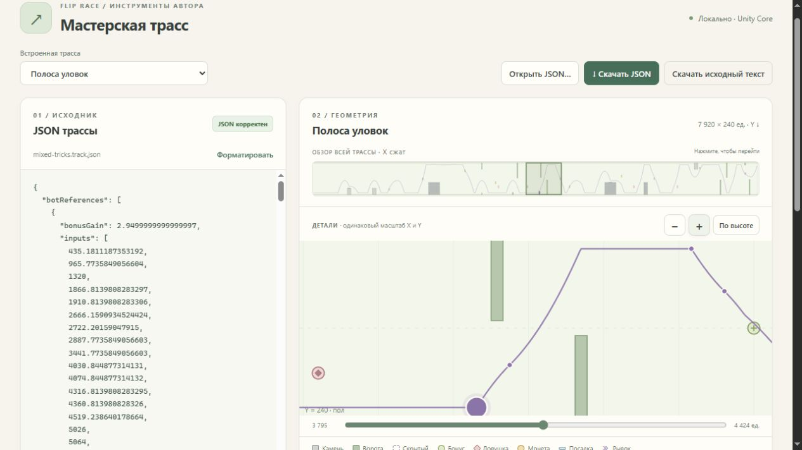

# Приёмка мастерской трасс 0.1

Принято 4 ноября 2026 по прямому поручению пользователя: открыть и редактировать JSON, сразу видеть схему и воспроизводить список нажатий. Отдельный инструмент, совместимый с Unity Flip Race 5.4.3 / schemaVersion 1 / physicsVersion 1. Игровая сборка не менялась. [Постоянная инструкция](../../flip-race/docs/authoring/workshop.md), [STATUS](TRACK-WORKSHOP-STATUS.md).

## Результат

- [Запуск готовой папки](../Builds/TrackWorkshop-0.1/Start.cmd), адрес http://127.0.0.1:4186/.
- [ZIP для Windows](../Releases/track-workshop-0.1-win-x64.zip). Нужен ASP.NET Core Runtime 8 либо .NET 8 SDK.
- 24 файла, 1 323 961 байт до сжатия; ZIP 357 050 байт. SHA256 ZIP: `49480843475B468F4C7923B17EA7F1EB3824C70C2BED476F4AE4B6ED18B15F78`.
- Пакет распакован в `Builds/TrackWorkshop-0.1-zipcheck`: 24/24 файла совпали по SHA256, лишних файлов нет. Настоящий Start.cmd запущен из другой текущей папки (`F:/Home/Game`); каталог, статика и расчёт доступны без обращения к соседним исходникам.

## Проверки

| Требование | Доказательство |
| --- | --- |
| WS-01: строгий JSON и физическая схема | Общий TrackJson и ObstacleGeometry/FinishTargetGeometry; обе части ворот, offsets, посадочная плоскость, четыре финишных штриха. Неверные данные не объявляются готовыми для игры. |
| WS-02: реальный replay | `dotnet run --project Tools/TrackWorkshop/Tests/TrackWorkshop.Tests.csproj`: 1683 утверждения, 8 карт, 15 эталонов по X и 15 эквивалентных списков по времени. [results.json](../Tools/TrackWorkshop/Tests/results.json). Совпали принятые времена, чистые проходы и награды; проверены ignored/unreached, лимиты, неверный ввод, отсутствие рестарта после финиша и hidden-состояния. |
| WS-03: интерфейс | 5/5 тестов `node --test Tools/TrackWorkshop/Web/tests/model.test.mjs`; браузер 1280×720 и 568×900. Редактор, переход к событиям, масштабирование, play/pause, ползунок, явные ошибки и сброс старой траектории. На узком экране нет горизонтального переполнения страницы. |
| WS-04: независимая проверка | [Review](track-workshop-review.md): исправлены маршрут модуля JavaScript и отображение negative-ловушки; оставшихся блокеров в просмотренном коде нет. |
| WS-05: экспорт и поставка | Файл скачан браузером, повторно открыт через выбор файла и проверен API/TrackJson: gameValid=true, ID workshop-browser-check, второе препятствие X=1090, 0 botReferences. [Фактический экспорт](track-workshop-browser-export.json). ZIP и launchers проверены. |

В браузере «Полоса уловок» с эталоном Основного дала 33,05 с, 0 ударов, 9 обычных бонусов и финишный рывок. «Передумай» дала 34,85 с без ударов, видны события Hidden/Warning/Solid. При переходе с Быстрого на эту карту показано явное уведомление о смене разрешённого профиля. Временной ввод `[1, 2, 4]` на изменённой карте дал 39 с и 6 ударов; `[1, 0.5]` отвергнут без автоматической сортировки.

Ввод `{` оставляет подписанную последнюю корректную схему и отключает расчёт. Изменение геометрии с прежними botReferences показывает предупреждение, экспортная кнопка явно предлагает файл без эталонов; исходный текст не переписывается. После открытия сохранённого файла схема снова корректна. Консоль браузера: ошибок/предупреждений приложения не зафиксировано. После запуска распакованного пакета страница перезагружена, эталон повторно построен: 33,05 с без ударов. API распакованного пакета: 8 карт, «Передумай» 34,85 с без ударов.

## Сохранение и ограничения

65/65 SHA256 игрового снимка из `v543-json-tracks-ui.json` совпали; working/staged diff и статус Assets пусты. Неизменны замороженная база `accepted-14e22ba.json` и чужой `FIX491-RELEASE.md`; подробные хеши в review. Ни поведение ботов, ни игра на 4184, ни геометрия каталога не заменялись.

WORKSHOP сохраняет TRACKFILE/GATE/HIDDEN/CONTROL/REWARD/FINISH/SOLO/BOT через общий Core. Это SOLO снизу, без выбывания камерой; раскрытие другим игроком не моделируется. Метки событий наблюдаются с шагом до 1/120 с, не являются аналитическим решателем контакта. Максимум 120 с и 4096 нажатий. Оптимизатор, новые эталоны бота, мышиное изменение геометрии и постоянная библиотека в 0.1 отсутствуют. Автоматическая валидация файла не доказывает интересность или проходимость произвольного уровня.

Исполнители: workshop_engine и workshop_ui — Sol/high; независимая проверка hidden54_tracks — Sol/high; интеграция и браузерная приёмка — Каталитик в исходном чате.
