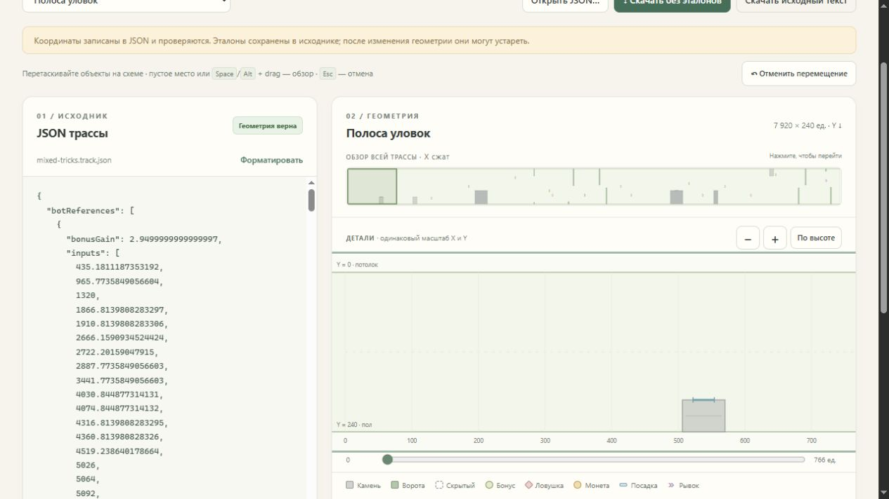

# Приёмка перемещения объектов — мастерская 0.2

Принято 4 ноября 2026. Источник: пользователь ожидал перемещение объектов мышью, а версия 0.1 передвигала только обзор. Исправление добавляет отсутствовавшее действие редактора; игровая физика, штатные трассы и backend расчёта не меняются. [STATUS](TRACK-WORKSHOP-DRAG-STATUS.md), [постоянная инструкция](../../flip-race/docs/authoring/workshop.md).

## Воспроизведение и исправление

В настоящей вкладке 0.1 перетаскивание камня на 90 пикселей влево оставило JSON неизменным и сдвинуло X viewBox с −20 до 73,857. Действие не зависело от модификаторов: обработчик любого pointerdown создавал pan. В 0.2 тип жеста и конкретный объект фиксируются в начале; после порога 4 пикселя двигается объект или фон. Кнопка мыши и DOM-перерисовка не меняют выбранную цель.

Превью не изменяет исходник. Отпускание записывает только необходимые числовые токены, затем запускается строгая проверка. Escape, pointercancel и потеря окна отменяют незавершённый жест. Кнопка отмены последнего переноса восстанавливает точный текст до него; новая ручная правка не затирается старой отменой. Устаревшая траектория сбрасывается, botReferences остаются в исходнике с прежним явным предупреждением.

## Проверки

`node --test Tools/TrackWorkshop/Web/tests/model.test.mjs`: **10/10 PASS**. Добавлены проверки группового сдвига и его границ, обеих частей gate и offsets, реальных форм наград/finish/landing, нулевых sentinel-полей, сохранения точного написания остальных чисел/текста и независимых предварительных перемещений. Syntax и diff checks успешны. [Независимая проверка Sol/high](track-workshop-drag-review.md) не нашла блокеров. Отдельный поиск сложных причин не требовался: отсутствие функции подтверждено документацией 0.1 и воспроизводимым жестом.

Реальные действия в браузере на опубликованной 0.2:

| Сценарий | Результат |
| --- | --- |
| Камень, drag влево с вертикальной составляющей | X 600 → 506,1; высота/ширина/стена прежние; landing X 632 → 538,1, Y 192. ViewBox неизменен. |
| Отменить перемещение | Полный текст JSON совпал с исходным, включая форматирование и refs. |
| Смещённые ворота, drag верхней части по X/Y | X 4050 → 4108,4; gapTop 110 → 141,3; gapBottom 130 → 161,3; offsets 0/112 сохранены, обе полосы видимы и ненулевые, ширина проёма прежняя. ViewBox неизменен. |
| Ловушка, drag по X/Y | (3820,180) → (3861,7;148,7), тип/radius/нули сохранены. |
| Drag пустого места | ViewBox изменился; JSON остался байт-в-байт прежним. |
| Прежние нажатия после изменения gate и ловушки | Новый replay завершился за 33,55 с с одним ударом; 9 обычных бонусов. Это расчёт новой геометрии, а не прежняя картинка. |
| Неверный JSON `{` | Расчёт, экспорт проверенного файла и старая отмена отключены; ошибочный исходник не подменён последней схемой. |
| Финальный UI после небольшой правки подписи | Повторён drag камня; после отпускания указано «координаты записаны в JSON», без приглашения повторно отпускать мышь. Отмена снова восстановила весь текст. |

Состояния отмены активного жеста Escape/cancel/blur и Alt/Space-pan проверены в source review; выше перечислены именно фактически выполненные браузерные сценарии. Консоль приложения без ошибок/предупреждений. [Точный исходник после браузерного переноса камня](track-workshop-drag-source.json) намеренно содержит прежние refs: API определил staleReferences=true; очищенная копия прошла общий TrackJson с gameValid=true и нужными координатами 506,1/538,1.

## Поставка и границы

[ZIP 0.2](../Releases/track-workshop-0.2-win-x64.zip): 363 651 байт, SHA256 `BC9D0602AFAC5546C4AE39FCFBBE052702499703A3C72E1FAA44DA414955CDD1`. После распаковки 24/24 файла совпали по хешам; объём файлов 1 347 268 байт. Web-файлы опубликованной папки совпадают с финальными исходниками. [Start.cmd](../Builds/TrackWorkshop-0.2/Start.cmd) реально запущен из другой текущей папки; мастерская доступна на 127.0.0.1:4186. Предыдущие ZIP/папки сохранены. Игра на 4184 продолжает работать.

Production Assets и C# API/симуляция не изменены, поэтому повторная полная матрица прежних эталонов не запускалась. Проверки 0.1 остаются свидетельством той базы; новые проверки относятся к перемещению и повторному расчёту. Автор самостоятельно проверяет проходимость новой геометрии. Изменение размеров и создание объектов остаются текстовыми операциями в JSON.
