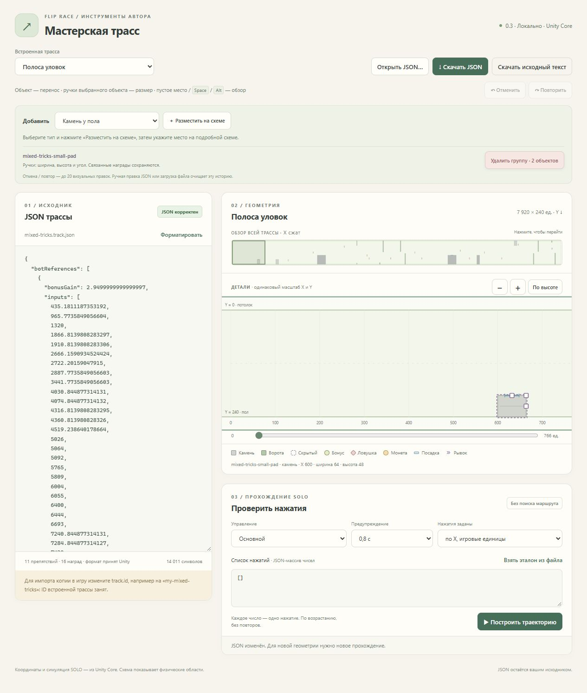

# Мастерская 0.3 — приёмка редактирования на схеме

4 ноября 2026. PASS. Основание — прямое поручение пользователя добавить создание, удаление и изменение размеров мышью. Сохраняемые контракты: WORKSHOP, TRACKFILE, GATE, HIDDEN, REWARD, FINISH. [Текущая статья](../../flip-race/docs/authoring/workshop.md), [STATUS](TRACK-WORKSHOP-EDIT-STATUS.md), [независимый review](track-workshop-edit-review.md).

## Выполнено

Палитра 12 видов → один клик размещения; выбор объекта → реальные ручки размеров и удаление. Камни сохраняют опорную стену, ворота обе части и offsets, посадки связаны с поверхностью камней. Удаление препятствия очищает все связанные награды с заранее показанным размером группы. Последний authored hidden удаляется атомарно со сменой warningMode на selected и уведомлением. Финиш имеет фиксированные Core-штрихи и не предлагает ложного resize.

История до 20 операций / примерно 16 МиБ восстанавливает точный текст; ручной ввод/форматирование/открытие файла сбрасывает её. Валидация, устаревание botReferences и расчёт реальной SOLO-траектории сохранены. Production Assets и встроенный каталог не изменены.

## Проверки

- `node --test Tools/TrackWorkshop/Web/tests/model.test.mjs Tools/TrackWorkshop/Web/tests/edit-model.test.mjs`: **26/26**, включая 10 прежних тестов 0.2. Интегратор повторил финальную версию.
- `node Tools/TrackWorkshop/Tests/EditorCheck.mjs`: **29 проверок настоящего C# /api/analyze**, все виды палитры, границы resize и offsets, связь посадки, каскадное удаление, последний authored hidden, устаревшие refs и пригодный очищенный экспорт. [Результат](../Tools/TrackWorkshop/Tests/editor-check-results.json).
- `dotnet publish Tools/TrackWorkshop/TrackWorkshop.csproj -c Release --self-contained false -p:UseAppHost=false -o Builds/TrackWorkshop-0.3`: успешно. Финальные Web-файлы синхронизированы и сверены по SHA256. Запуск Start.cmd из другой рабочей папки F:/Home/Game успешен.
- Независимый Sol/high review: без блокеров. Обновления модели и UI после первого прохода проверены исполнителями; правка последней модели отдельно покрыта 26-м набором тестов. Мелкое исправление удвоенной точки уведомления проверено синтаксически.

В IAB проверены настоящие click/drag, без подмены DOM-событий:

| Действие | Наблюдение |
| --- | --- |
| Добавить камень, потянуть угол | stone-1 создан; 64×48 → 105,7×79,3, X249,9; viewBox не сдвигается |
| Добавить посадку и расширить её | landing-1 связан со stone-1, Y160,7; ширина32→57, центр313,5 |
| Удалить камень с посадкой | кнопка заранее показывает2 объекта; оба исчезают; undo возвращает точный исходный текст; redo снова удаляет |
| Добавить ворота, изменить обе границы и толщину | gate-1 X350,1; gap80..160 →59,1..180,9; ширина16→36,9; обе полосы остаются |
| Добавить мгновенный бонус, растянуть радиус | instant-1 X500,2/Y119,8; радиус8→28,9 |
| Ввести ошибочный JSON `{` | создание/удаление/undo/redo/replay/export заблокированы; старая схема помечена |
| Вернуть корректный текст | анализ возобновлён, ручное изменение очистило визуальную историю |
| Проверить финиш | видна подпись о фиксированном размере, ручек0 |
| Потянуть пустое место | обзор сдвигается, исходный текст точно прежний |
| Перенести бонус | X500,2/Y119,8 →541,9/140,7, viewport прежний; undo точно восстановил текст |

Захваченный из редактора [исходный JSON](track-workshop-edit-browser-source.json) содержит новые ворота и увеличенный бонус. Это тестовая копия, не изменение штатной карты. В браузере она прошла финиш за **33,55с**, 1 удар,9 обычных бонусов и1 финишный. Старый эталон намеренно не подгоняли. [Повторная проверка сохранённого текста](track-workshop-edit-validation.json) подтверждает тот же результат и валидный экспорт без устаревших botReferences. Сохранённый JSON снят из поля редактора; отдельный повторный диалог скачивания в этой итерации не проверялся (не менялся с0.1).

Полная матрица15 маршрутов и production-тесты не повторялись: физика, каталог и backend replay не менялись. Изменён только явный статический маршрут нового браузерного модуля. Игра на4184 отвечает HTTP200, Assets diff пустой. Это не обещание проходимости произвольных созданных карт.

## Пакет и интерфейс

[ZIP0.3](../Releases/track-workshop-0.3-win-x64.zip), [Start.cmd](../Builds/TrackWorkshop-0.3/Start.cmd), [локальная мастерская](http://127.0.0.1:4186/).

26 файлов,1395144 байт распакованного содержимого; ZIP377065 байт. Контрольная распаковка в новую папку дала26/26 совпадающих SHA256, исходный Web совпал с опубликованным. SHA256 архива: `1E4507CEE5203B5CFDC43412E72CBBC816B90EE9A19E689A322546F4B7CD54AC`.

Новая вкладка оставлена с чистой штатной «Полосой уловок» и выбранным камнем, а тестовые правки сохранены отдельно. Нужен .NET8 ASP.NET Runtime либо SDK; сервер локальный, самостоятельный HTML расчёта не выполняет.

