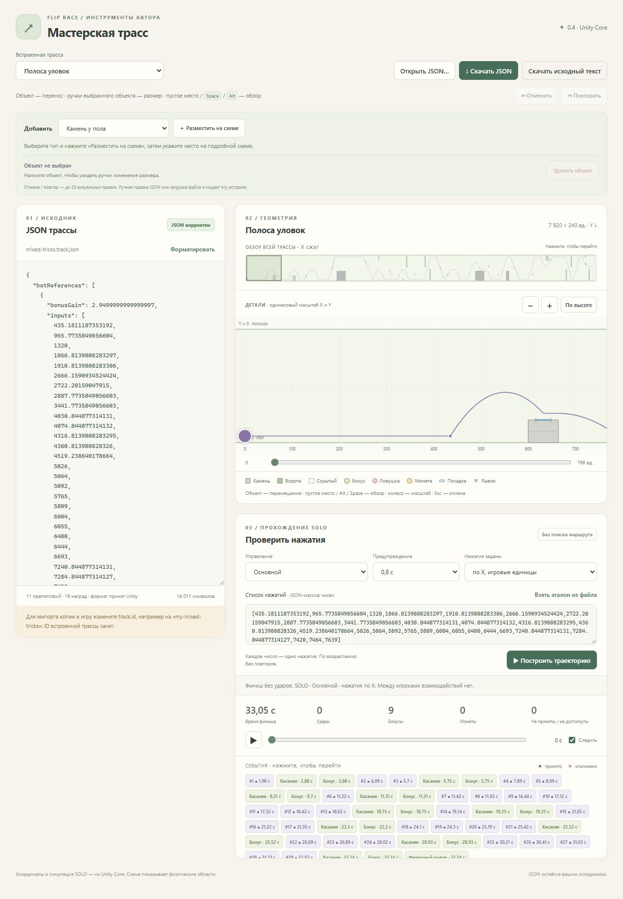

# Мастерская 0.4 — серверный выпуск

4 ноября 2026. PASS для готового серверного пакета и инструкции. Внешняя площадка не выбрана, публичного развёртывания нет. Основание — запрос пользователя «сделаем серверную версию и расскажи как развернуть ее», затем ответ «Пока не выбрал площадку». [STATUS](TRACK-WORKSHOP-SERVER-STATUS.md), [действующая статья](../../flip-race/docs/authoring/workshop.md), [инструкция](../Tools/TrackWorkshop/Deploy/README.md).

## Поведение

Обычный локальный запуск сохраняет 127.0.0.1:4186. Серверу задаются явные bind IP/port и публичный origin; для сетевого bind origin обязателен. Проверяются Host, порт, Origin и JSON content type; wildcard CORS и доверия forwarded headers нет. Максимум 2 одновременных analyze/replay по умолчанию, диапазон 1..32; лишний запрос получает 429/Retry-After:1. Лимит действует до чтения тела и до окончания ответа, освобождается при ошибке/отмене. `/healthz` сообщает версию.

Docker Compose: Caddy с HTTPS и Basic Auth закрывает UI и API, app работает пользователем `app`, без опубликованного порта во внутренней сети. Сертификаты Caddy сохраняются в named volumes. Пользовательские JSON/нажатия обрабатываются в памяти и не записываются в каталог. Никакой общей библиотеки/совместного документа не добавлено. Core/Assets и девять JSON каталога неизменны.

Серверный пакет опубликован для net10.0 и проверен на **Microsoft.AspNetCore.App10.0.14 / Microsoft.NETCore.App10.0.14** в Linux-контейнере. Локальный пакет сохраняет net8.0. Причина отдельной серверной цели — окончание поддержки .NET 8 10 ноября 2026; .NET 10 LTS поддерживается до 14 ноября 2028. [Официальная политика](https://dotnet.microsoft.com/en-us/platform/support/policy/dotnet-core).

## Свидетельства

- **75 проверок** ServerTests: настройки/диапазоны, loopback, точные Host/Origin, отсутствие forwarded-доверия, занятость, доступность GET, освобождение после ошибок/отмены. Исполнитель выполнил на net8.0 и net10.0; [результат](../Tools/TrackWorkshop/ServerTests/results.json). Команда для сервера: `dotnet run --project Tools/TrackWorkshop/ServerTests/TrackWorkshop.ServerTests.csproj -p:WorkshopTargetFramework=net10.0`.
- **20 реальных HTTP-проверок** отдельного net10-процесса на 127.0.0.1:4197 с origin https://workshop.example.com: корректные/чужие Host и Origin, неверные тела/тип, запрет чтения исходников и каталогов, реальный replay. [Результат](../Tools/TrackWorkshop/ServerTests/smoke-results.json). В Smoke.mjs использован http/https.request: Node20 fetch игнорировал тестовый Host, что было отдельно подтверждено curl. Приложение для исправления теста не ослаблялось.
- **18 проверок через настоящий Caddy HTTPS+Basic Auth** в локальном Docker, финальный app — net10.0. Временный прокси опубликован только 127.0.0.1:4191; сертификат localhost проверялся клиентом через явно переданный публичный тестовый CA, без отключения TLS-проверки и без установки CA на хост. UI/API/health без пароля и неверный пароль→401; верный вход,8 карт, анализ, JS-модуль, чужой Origin/тип/невалидный JSON, оба эталона. [Результат](track-workshop-server-proxy.json), [runner](../Tools/TrackWorkshop/ServerTests/ProxySmoke.mjs). Chosen и FastFlip «Полосы уловок»:33,05 с,0 ударов.
- Compose config и отказ при пустом password hash, реальный `caddy validate` прошли. Конечный Caddyfile использует environment placeholders; работа с настоящим хешем, содержащим `$`, подтверждена входом через Compose.
- Независимый [review](track-workshop-server-review.md): найденный обход ограничения через trailing slash устранён и покрыт тестами; оставшихся блокеров нет.
- Браузер IAB с готовым локальным пакетом 0.4: каталог и редактор загружаются, эталон из файла строит траекторию, итог 33,05 с/0 ударов. Интерфейс соответствует тому же Web, что в серверном пакете. Вход через браузерный HTTP-auth диалог отдельно не автоматизировался; авторизацию подтвердил реальный HTTPS-клиент.
- Все 7 Web-файлов и 9 JSON каталога в серверном пакете совпали с исходниками по SHA256; `git diff -- Assets` пустой. Изменение игровых механик не заявляется; полная матрица 15 маршрутов в этой итерации не повторялась.

## Сборка и пакеты

Сервер: `dotnet publish Tools/TrackWorkshop/TrackWorkshop.csproj -c Release --self-contained false -p:UseAppHost=false -p:WorkshopTargetFramework=net10.0 -o Builds/TrackWorkshop-0.4-server/app`, затем копирование 6 Deploy-файлов в корень. Docker image собирается из этого готового app/. Из-за ошибки Windows-пути телеметрии установленного Buildx локальная проверка использовала встроенный builder с `DOCKER_BUILDKIT=0` только на время команды. Это настройка локального теста, не требование серверного README.

| Пакет | Файлов | ZIP,байт | SHA256 |
| --- | ---: | ---: | --- |
| [Серверный 0.4](../Releases/track-workshop-0.4-server.zip) |32|386831|`5F1706589626563E214939F1EF528805AEA2A08D2C554118496B00C7429DC024`|
| [Локальный 0.4](../Releases/track-workshop-0.4-win-x64.zip) |26|381774|`97AE51D5F0E755A266C5FB30AD177FF7C3F0177D09CC4C2380E3A08CB134309E`|

Оба архива распакованы в новые папки, все файлы совпали. `.env.example` и `.dockerignore` присутствуют; настоящие пароли, тестовый CA и `.env` в поставку не вошли. [Машинная сверка](track-workshop-server-packages.json).

Временный процесс 4197, контейнеры и тома проекта track-workshop-04-check остановлены/удалены после проверки. Удалённые Docker-контексты не изменялись, на них не запускались контейнеры. Обычная мастерская 0.4 оставлена на 4186; публичный домен/ACME и работа на выбранном VPS требуют последующей проверки при развёртывании.

